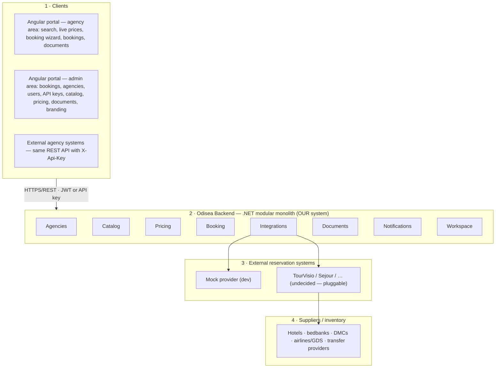

# Odisea v2 — Architecture Overview

> Living document. Update it in the same PR as any structural change (new module, new external system, changed boundaries). Last updated: 2026-10-24 (backend through the reservations MVP: passenger data, submit → payment → admin confirmation, API keys for external agencies).

## What Odisea is

A **B2B travel platform** for a tour operator (Paradise Travel). The operator composes its own packaged offers — accommodation + transport + transfer + insurance + extras — and distributes them to partner **travel agencies**, which search, see live-calculated prices, and book. Agencies sell the package as-is; the operator controls product, price and inventory sources. Agencies reach the platform either through the portal or, as integrated partners, directly through the API with an agency key.

## The four tiers



The key business flow: agent searches a program → Catalog resolves allowed hotels → Integrations asks the provider for net prices → Pricing applies markup + commission + fees → agent sees the final B2B price → draft with full passenger data → **re-price** (availability and price re-checked) → **submit** (the provider holds the reservation, a payment deadline starts) → operator records the payment → **operator admin confirms** → Documents issues the invoice → voucher (later).

## Backend: modular monolith

One deployable (`Odisea.Api`), six modules, hard boundaries:

| Module | Owns | Depends on (PublicApi only) |
|---|---|---|
| **Agencies** | Identity & authentication (JWT for people, API keys for partner systems), agencies, users, roles, credit limits, commission levels, **plans and feature entitlements** (`IAgencyEntitlements`), the DataProtection key ring | — |
| **Catalog** | Destinations, hotels, programs, departures, allowed-hotel lists, **hotel/location mappings** (internal ↔ provider codes), live search with protected offer envelopes | Integrations (provider search, token protection), Pricing (sell price) |
| **Pricing** | Pricing rules (markup/fee/commission), exchange rates, the pure pricing engine | — |
| **Booking** | Reservation lifecycle (state machine with actors), passengers with encrypted travel documents, payments, operator oversight | Agencies (agency active check, policies), Catalog (program refs), Pricing (breakdown), Integrations (re-price/book/cancel) |
| **Integrations** | `IReservationProvider` contract, provider adapters (Mock now, real later), offer-token protection, call logs | — |
| **Documents** | Bulgarian tax documents (фактури, известия): gapless numbering, margin scheme, PDFs, company profile; contract documents filled from operator-uploaded Word templates (placeholder catalogue, custom fields, versioned templates, sharing with agencies, agency self-service) | Agencies (billing + contract facts), Booking (financial + contract facts incl. passengers) |
| **Notifications** | Transactional e-mail outbox (`IEmailOutbox`), background dispatcher with retry/backoff, SMTP (MailKit) or logging transport, operator view of what went out | Agencies (policies) |
| **Workspace** | The paid agency tier: external reservations (agency's own reference and status, free-form JSON payload, timeline with actors, anonymous customer tracking page), inquiry forms (public submission endpoint for agency websites: JSON or HTML form posts, honeypot, origin allowlist, redirect, notification and auto-reply mail), usage per agency for billing | Agencies (policies, `IAgencyEntitlements`, agency name), Notifications (`IEmailOutbox`) |

**Boundary rules (enforced by an architecture test over every ordered pair of modules):**
- A module may reference another module **only through its `PublicApi` namespace**.
- Cross-module references are plain `Guid`s — no shared entities, no cross-schema FKs.
- Communication is direct interface injection. No MediatR, no event bus.
- Provider-specific state (raw offer tokens, external codes) never leaks past Integrations adapters; clients only ever hold a DataProtection-wrapped `OfferEnvelope` that also pins the agency, hotel and occupancy an offer was issued for.

**Module internal layout:** `PublicApi/` · `Domain/` · `Features/<feature>/` · `Infrastructure/` (DbContext + migrations) · `Controllers/` · `<Name>Module.cs` (DI extension). Namespace = folder.

**Host startup:** `StartupMigrator` (an `IHostedService`) migrates every module schema (Agencies last) and runs the seeders before the server listens — the same path runs under `WebApplicationFactory` in the integration tests.

## Data architecture

One PostgreSQL database, **one schema + one DbContext + one migrations history table per module**: `agencies`, `catalog`, `pricing`, `booking`, `integrations`, `documents`, `notifications`, `workspace`. snake_case naming, enums stored as strings, version-7 GUIDs (time-ordered → append-only B-tree inserts). `SharedKernel` provides `Entity`, `Money`, `DateRange`, `Pax`, `IClock`, `ICurrentUser` — no EF, no HTTP.

Sensitive columns: passenger document numbers are encrypted with a DataProtection value converter (`booking.booking_passengers.document_number`); refresh tokens and API keys are stored as SHA-256 hashes. The DataProtection key ring lives in `agencies.data_protection_keys` (not yet encrypted at rest — #153). Bookings carry an `xmin`-based optimistic concurrency token.

## Reservation lifecycle

```
Draft ─re-price─▶ PriceConfirmed ─submit─▶ PendingConfirmation ─provider OK─▶ AwaitingPayment ─admin confirm (fully paid)─▶ Confirmed
  │ cancel (agency)  │ cancel (agency)  │ provider KO → Failed            │ reject (operator)                      │ cancel (admin)
  ▼                  ▼                  │ cancel (admin rescue)           │ expire (operator, past PaymentDueAt)   ▼
Cancelled          Cancelled            ▼                                 │ cancel (agency, if unpaid; or admin)  Cancelled
                                      Cancelled                          ▼
                                                                  Rejected / Expired / Cancelled
```

- **Submit** validates completeness (party matches the priced occupancy by count and adult/child mix at check-in; every passenger has gender, birth date, nationality and a travel document valid through check-out; exactly one lead with email and phone), persists `PendingConfirmation` *before* the provider call, then records the outcome. The provider holds the reservation; `PaymentDueAt` comes from the `Booking` options.
- **Payments** are records (voided, never deleted); paid amount and balance are computed. Only an **operator admin** confirms, and only once the reservation is fully paid. Documents treats that confirmation as the tax event.
- **Who did what** is on every history row (`Agency`, `ApiClient`, `Operator`, `System` + user id). Details and the operator endpoint table: [Booking README](../backend/src/Modules/Odisea.Modules.Booking/README.md).

## Auth & security model

- **Two ways in, one identity shape.** Portal users log in and get a JWT (HS256, secret ≥ 256 bits, validated at startup; 15-minute access tokens, HttpOnly refresh cookie with rotation and reuse detection). External agency systems send a per-agency API key in `X-Api-Key` (`odk_live_…`, hashed at rest, operator-issued and revocable, optional expiry). The default authentication scheme is a selector: header present → API-key handler, otherwise JWT bearer. Both produce `sub`, `name`, `user_type` (`operator`|`agency`), `role`, `agency_id` (agency callers); key callers additionally carry `role=ApiClient` and `auth_method=api_key`.
- **Deny by default:** a fallback authorization policy requires authentication on every endpoint; only `/api/v1/auth/login|refresh|logout`, `/health`, the public branding reads (`/api/v1/branding`, `/api/v1/branding/logo`) and the workspace public endpoints (`/api/v1/public/track/{code}`, `POST /api/v1/public/forms[/{accessKey}]`; any origin, per-IP rate limit, no personal data returned) are `[AllowAnonymous]`.
- **Policies** (`Agencies.PublicApi.AuthPolicies`, consumed by all modules): `Operator` (back-office), `OperatorAdmin` (operator with role `Admin`: confirm a paid reservation, cancel it, void a payment), `Agency` (portal users and API keys alike). A key can never satisfy an operator policy or obtain a session.
- Agency-scoped queries always filter by the **`agency_id` claim**, never by a client-supplied id; offer envelopes additionally bind agency, hotel and occupancy. Not-found and not-yours are the same 404.
- Login hardening: PBKDF2 hashing, 5-failure/15-min lockout, anti-enumeration (identical error + dummy hash). Full baseline and remaining checklist: issue #100.
- Perimeter: rate limiting on auth (10/min/IP) and per API key (60/min, hash-partitioned), security headers (nosniff, frame DENY, no-referrer), strict CORS allowlist from config, HSTS outside Development, `Cache-Control: no-store` on `/api`.
- The provider's **net cost never reaches agencies**: operator-only DTOs are the sole carriers, and `NetCostLeakGuardTests` scans every other DTO by convention. Passenger document numbers never appear in logs, notes or error messages.
- Supply chain: Dependabot (nuget + actions + npm) and CodeQL run in CI.

## Provider abstraction (tier 3)

`Odisea.Modules.Integrations` defines the provider-neutral contract: search → re-price → book → cancel → status (a content-sync interface for hotel/location catalogs arrives with the first real adapter). Booking passes full traveller data (type, gender, nationality, travel document, lead contact) so a real system can register passengers. Each external system is one adapter behind `IReservationProvider`; the **Mock adapter** is a first-class citizen (deterministic inventory, configurable availability failures and re-price drift, occupancy checks) so every flow is testable before any real credentials exist. The real intermediary system (TourVisio vs Sejour, both SAN TSG) is deliberately undecided — the contract is indifferent. Hotel/location **mappings live in Catalog**; unmapped search results are dropped and logged, never shown half-mapped.

## Frontend

One Angular 21 app (`frontend/portal`) shipped as a **white-label build**: standalone components, signals, strict templates, SCSS. `core/` (auth, interceptor, guards, branding + theme derivation) · `shared/ui/` (the component kit from the design canvas: page header, cards, status chips, deadlines, timeline, dialogs, toasts, icons — one SCSS file per component) · `layout/` (sidebar shell with a mobile drawer, agency + admin nav) · `features/{auth,agency,admin}`. Routes `/login`, `/agency/**`, `/admin/**`, lazy-loaded. At startup the portal loads `GET /api/v1/branding` and dresses itself (the two brand colours become CSS tokens plus derived AA-contrast inks, name, logo, favicon, support contact, legal footer), so one build serves every operator deployment. The agency area follows the reservation contract end to end: occupancy-sized passenger form with travel documents and one lead → draft → re-price with drift warning → submit → awaiting payment, with payment status and the actor trail in the bookings list. The admin area covers bookings oversight (`/admin/bookings`: filtered, paged list across agencies, detail with net cost, breakdown, passengers, payments, the actor trail, the operator actions gated in the UI the same way the `OperatorAdmin` policy gates them in the API, and invoice issuance once confirmed), partner agencies (profile, billing requisites, users, API keys issued once and revoked, plan), the catalogue (programs with departures, allowed hotels and a publish checklist; hotels and destinations with supplier mappings), pricing rules and exchange rates, documents (invoices, credit notes, annulment, PDFs) and settings (branding with live preview, company profile). The agency area adds offer cards with compare, a four-step wizard that resumes drafts, a booking detail page and phone layouts with a bottom tab bar.

## Dev & verification workflow

```
docker compose up -d db        # Postgres 17 on host port 5433
dotnet run --project backend/src/Odisea.Api    # migrate + seed + listen on :8080
# Swagger UI: http://localhost:8080/swagger  (Authorize: JWT bearer or X-Api-Key)
# Dev login: admin@odisea.local / DevOnly-Odisea-Admin-2026!  (Development seeding only)
```

Every slice must pass: `dotnet build` (warnings = errors) · `dotnet test` (unit + architecture tests on EF InMemory, and HTTP integration tests over the real host against Postgres — the compose db must be up) · a live Swagger/API smoke against real Postgres. CI repeats build + test (with a Postgres service) on every PR; CodeQL scans on every push to main.

## Document map

- [SYSTEM-OVERVIEW.md](SYSTEM-OVERVIEW.md) — the big picture in diagrams: tiers, module dependencies, request pipeline, reservation lifecycle, end-to-end sequence, schemas, endpoint map
- [ROADMAP.md](ROADMAP.md) — phases, status, what's next
- Per-project READMEs — purpose and relations of each project (`backend/src/**/README.md`, `backend/tests/**/README.md`)
- Project board — https://github.com/orgs/odisea-network/projects/1 (source of truth for tasks)
- v1 (thesis project) — branch `archive/v1`, tag `v1.0-final`
