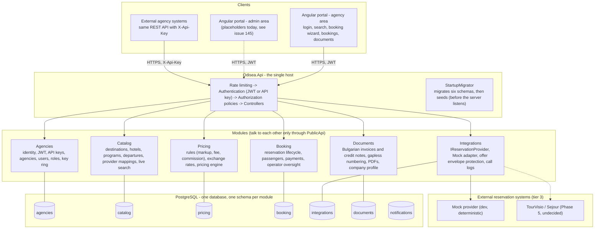
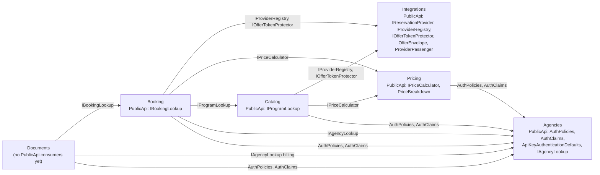
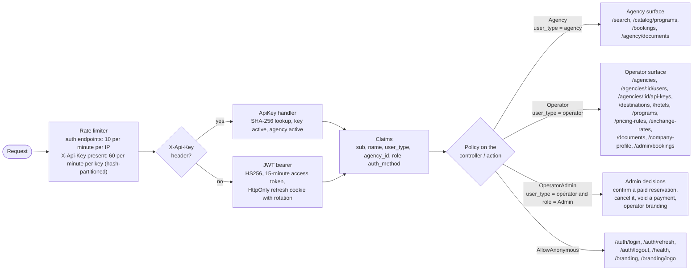
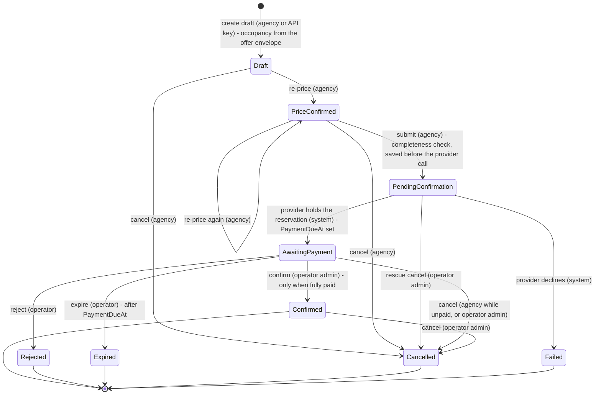
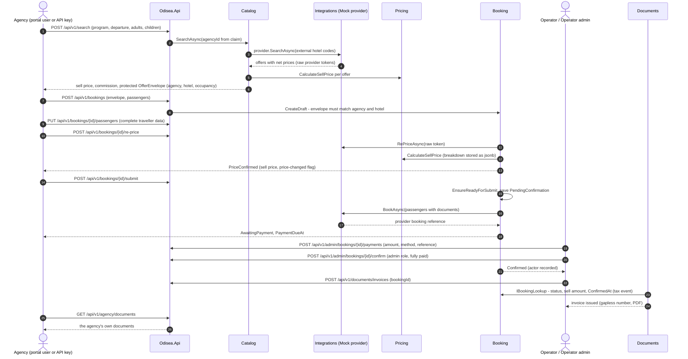
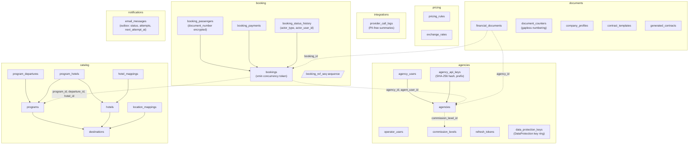
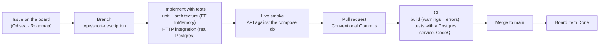

# Odisea v2 — System Overview (diagrams)

> The big picture of what exists today, as of 2026-10-24. Diagrams are Mermaid and render on GitHub. For the narrative and the rules behind each box, see [ARCHITECTURE.md](ARCHITECTURE.md); for status, [ROADMAP.md](ROADMAP.md).

## 1. The whole system

Who talks to what. Solid lines exist today; dashed lines are planned or undecided.

## 2. Module dependencies

Each arrow is a `PublicApi` contract one module consumes from another. Everything also references `SharedKernel` (`Entity`, `Money`, `DateRange`, `Pax`, `IClock`, `ICurrentUser`, `DomainException`), and the host wires all six modules. An architecture test fails the build if any module reaches past another module's `PublicApi`.

Cross-module references in data are plain `Guid`s. No module shares an entity or a foreign key with another.

## 3. Request pipeline: who gets in, and where

Two facts hold everywhere: the agency id always comes from the `agency_id` claim, never from the request, and the provider's net cost is only ever carried by `Operator*` DTOs (a guard test scans every other DTO).

## 4. Reservation lifecycle

Who may trigger each transition is in parentheses. `Rejected`, `Expired`, `Cancelled` and `Failed` are terminal.

Payments are separate records (voided, never deleted); the paid amount and balance are computed. Every transition stores the actor (`Agency`, `ApiClient`, `Operator`, `System`) and the user id.

## 5. End-to-end: from search to invoice

## 6. Data: one database, six schemas

Solid arrows are foreign keys inside a schema. Dashed arrows are `Guid` references across schemas, deliberately without foreign keys.

Conventions everywhere: snake_case names, enums stored as strings, version-7 GUID keys, a separate `__ef_migrations_history` table per schema, migrations per module under `Infrastructure/Data/Migrations/`.

## 7. Endpoint map by audience

| Audience | Endpoints | Notes |
|---|---|---|
| Anonymous | `POST /api/v1/auth/login`, `POST /api/v1/auth/refresh`, `POST /api/v1/auth/logout`, `GET /health`, `GET /api/v1/branding`, `GET /api/v1/branding/logo` | auth endpoints rate limited 10/min per IP; branding reads are public and cacheable |
| Agency (portal user or API key) | `GET /api/v1/catalog/programs`, `GET /api/v1/catalog/programs/{id}`, `POST /api/v1/search`, `POST/GET /api/v1/bookings`, `GET /api/v1/bookings/{id}`, `PUT /api/v1/bookings/{id}/passengers`, `POST /api/v1/bookings/{id}/re-price`, `POST /api/v1/bookings/{id}/submit`, `POST /api/v1/bookings/{id}/cancel`, `GET /api/v1/agency/documents[/{id}[/pdf]]`, `GET /api/v1/agency/plan`, `GET /api/v1/agency/contract-templates`, `GET/POST /api/v1/agency/contracts`, `GET /api/v1/agency/contracts/{id}/file` | scoped by the `agency_id` claim; keys additionally limited to 60/min |
| Operator | `/api/v1/agencies` (+ `/{id}/users`, `/{id}/api-keys`, `/{id}/billing`, `/{id}/plan` admin-only), `/api/v1/destinations`, `/api/v1/hotels`, `/api/v1/programs`, `/api/v1/pricing-rules`, `/api/v1/exchange-rates`, `/api/v1/documents` (invoices, credit notes, annul, pdf), `/api/v1/company-profile`, `/api/v1/contract-templates` (upload/replace/delete are admin-only), `/api/v1/contracts` (generate, data preview, file, share), `/api/v1/admin/emails` (outbox; retry, cancel, dispatch, test are admin-only), `GET /api/v1/admin/bookings[/{id}]`, `POST /api/v1/admin/bookings/{id}/reject`, `/expire`, `/payments` | back-office; sees net cost and breakdown |
| Operator admin | `POST /api/v1/admin/bookings/{id}/confirm`, `/cancel`, `/payments/{paymentId}/void`, `PUT /api/v1/branding`, `PUT/DELETE /api/v1/branding/logo` | irreversible money decisions, white-label branding |

## 8. How a change ships

Test counts at the time of writing: 194 unit and architecture tests, 24 HTTP integration tests.

## What is not here yet

- Portal: the booking wizard still calls the retired `/confirm` route and collects only names; the admin area is placeholders (issue 145).
- A real reservation provider behind `IReservationProvider` (Phase 5, gated on the TourVisio-vs-Sejour decision and sandbox credentials).
- Automatic expiry of unpaid reservations, partner webhooks, idempotency keys for partner retries, audit log, vouchers, credit-limit enforcement, encrypted key ring at rest (issues 150 to 154, #100).
